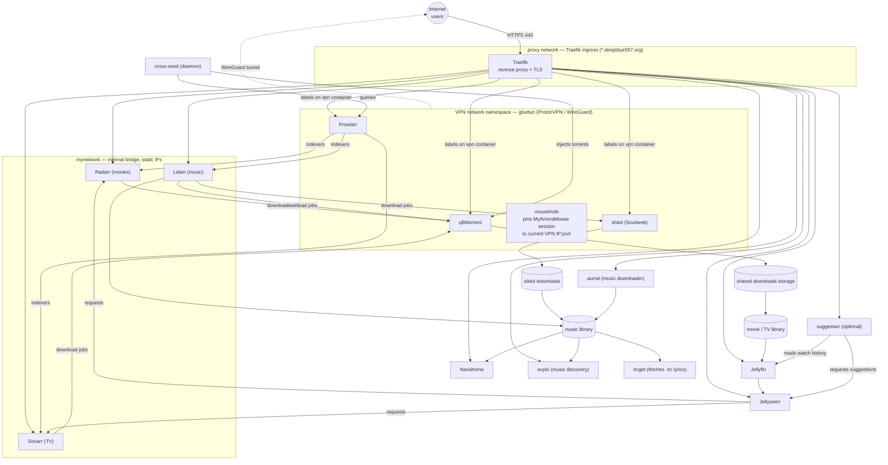

# Architecture

This document describes how the services in `docker-compose.yml` fit together on this
particular deployment: networking, the VPN boundary, and the media acquisition →
library → streaming pipeline.

## Overview diagram

## Networks

Three distinct networks are in play, and most of the complexity in the compose file
comes from services needing to reach each other across them:

- **`mynetwork`** — an external, pre-created bridge network (`172.20.0.0/16`) used for
  direct container-to-container traffic. Radarr, Sonarr, and Lidarr are given **static
  IPs** on this network because Prowlarr runs inside the VPN container's network
  namespace and can't resolve them by Docker service name — it has to reach them by IP.
- **`proxy`** — an external network that only exists to give Traefik a path to every
  service's web UI. Anything with a public subdomain joins this network and carries
  `traefik.*` labels declaring its router rule and internal port.
- **VPN network namespace** — `vpn` (gluetun) is the only container that actually holds
  a network stack; qBittorrent, Prowlarr, slskd, and mousehole all run with
  `network_mode: service:vpn`, meaning they share gluetun's namespace and IP. Every
  byte they send leaves through the ProtonVPN WireGuard tunnel. Because of this, their
  Traefik labels live on the `vpn` service itself — Traefik has to reach them via the
  `vpn` container's ports, not their own.

## Why `mousehole` and `cross-seed` exist

- **mousehole** solves a private-tracker problem: MyAnonaMouse ties your session to a
  specific IP/port. Since qBittorrent's visible IP changes with the VPN, mousehole
  keeps MAM's records pointed at whatever IP/port the VPN currently has, so seeding
  keeps counting correctly.
- **cross-seed** is a separate daemon (not behind the VPN) that queries Prowlarr's
  indexers for matches to torrents already sitting in qBittorrent, and injects the
  matches back into qBittorrent — maximizing cross-tracker seeding/ratio without manual
  searching.

## Storage layout

Two physical locations back all the volumes:

- `/mnt/mediaSSD/mediaStack/*-config` — fast SSD storage for every app's config/database
  (Radarr, Sonarr, Lidarr, Prowlarr, qBittorrent, Jellyfin, Jellyseerr, Navidrome, explo,
  aurral, lrcget, slskd, cross-seed, suggestarr).
- `/mnt/media/mediaStack/*` — bulk spinning storage for actual media content:
  `torrent-downloads`, `music`, `slskd` (Soulseek downloads), and `Books`.

Configs are kept on the SSD for responsiveness (frequent small writes: databases,
metadata); media itself lives on bulk storage since it's large and sequential.

## Profiles

- `vpn` — brings up `vpn` (gluetun) plus everything that needs to run behind it
  (qBittorrent, Prowlarr, slskd, mousehole).
- `no-vpn` — the same download-facing services, attached directly to `mynetwork`
  instead of tunneling through gluetun. Not recommended for torrenting.
- `suggestarr` — opt-in, brings up the recommendation service (Suggestarr) separately
  from the above two.
